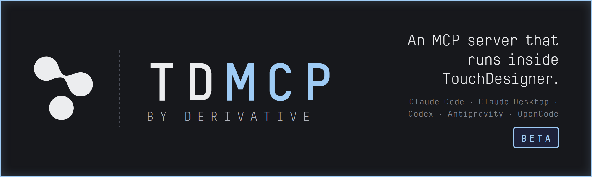
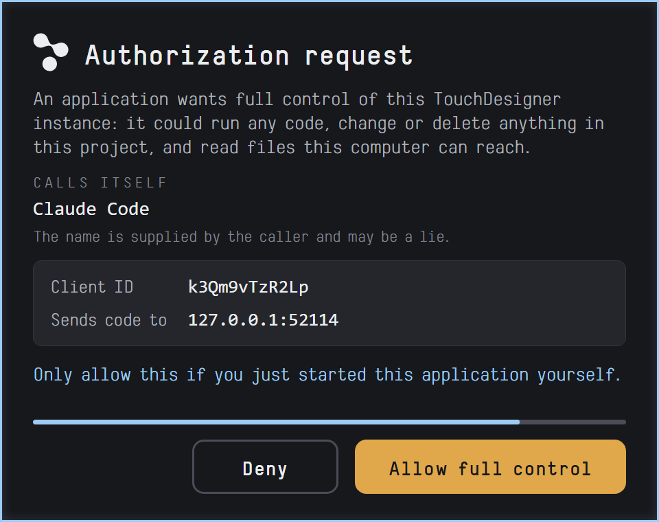

> ### Beta
>
> TDMCP is in public beta. The component works and is in daily use, but the
> interface may still change. Found a bug, or want to ask something? Start a
> [discussion](https://github.com/TouchDesigner/TDMCP/discussions) and include
> the **Version** and **.tox Save Build** from the component's About page.

## What it is

TDMCP is an MCP server that runs inside TouchDesigner. Drop one component into
your project and your AI agent can build and edit networks with you: create
operators, wire them, set parameters, write DAT and GLSL code, read errors and
cook times, look up the TouchDesigner docs, and capture what an operator
outputs. Everything it does lands in TouchDesigner's undo stack, so Ctrl+Z
reverses it.

It works with Claude Code, Claude Desktop, Codex, Antigravity, OpenCode, and any
other client that speaks streamable-HTTP MCP.

## Start here

Requires **TouchDesigner 2025.33230 or newer**.

1. Download `TDMCP.tox` from [Releases](https://github.com/TouchDesigner/TDMCP/releases)
   and drag it into the root of your project.
2. Turn on **Active** on the component's MCP page.
3. Connect your agent. Pick your client in **Install For**, copy **Add MCP**,
   and run it in your project directory. Then pulse **Install Skills**.

For Claude Code, **Add MCP** gives you:

```bash
claude mcp add --transport http --scope local touchdesigner http://127.0.0.1:13316/mcp
```

Then ask your agent:

> What TouchDesigner project am I connected to?

A correct answer means the server is running, the client found it, and a tool
call round-tripped. Now try something real:

> Create a noise TOP, blur it, and end the chain in a null.

**Claude Desktop** has no command to run. Download `TDMCP.mcpb` from the same
release, open **Settings → Extensions** and drag the file onto that page. For
the skills, open **Settings → Plugins → Add → Upload a plugin** and drop in the
TDMCP Skills plugin zip file. Then turn on **Inline Images** on the component's Tune
page, so Claude can see what it builds. Details in
[Claude Desktop](docs/setup-advanced.md#claude-desktop).

## Download

Every release carries the same three files.

| File | What it is |
|---|---|
| **TDMCP.tox** | The component. This is the server. |
| **TDMCP.mcpb** | The Claude Desktop extension. Other clients do not need it. |
| **TDMCP-Skills-*.plugin** | The skills, packaged for Claude Desktop. Other clients get them from **Install Skills**. |


## What you can do

| | |
|---|---|
| **Build** | Create and wire operators, set parameters, add custom parameters, write DATs and shaders, lay out and annotate the network. One call can build a whole chain. |
| **Inspect** | Read CHOP channels, TOP pixels, geometry and DAT content. Capture any operator as an image. Trace errors and cook times. |
| **Learn** | The agent reads TouchDesigner's own documentation through `get_docs`, and looks up parameter names and menu values before it sets them. |
| **Watch** | The network editor pans to whatever the agent is touching and flashes it: amber for edits, blue for inspections, violet for views. |
| **Undo** | Every change the agent makes is an undo step. There is an option to ask first before deleting an operator. |

26 tools in all. The full list, with what each one does, is in the
[component reference](docs/component.md#tools).

## Skills

Skills teach the agent how TouchDesigner works: one guide per operator
family, the conventions for network layout and performance, and a workflow for
planning, reviewing and cleaning up. Without them, the agent might guess
at parameter names and build networks that don't work.

The skills live in [TDMCPSkills](https://github.com/TouchDesigner/TDMCPSkills).
Pulse **Install Skills** on the component and it fetches the latest release
and puts it where your client looks. Claude Desktop gets the same skills as a
plugin upload. The [component reference](docs/component.md#skills) lists the
directory for each client.

## Stay in control

The server exposes `execute_code`, which runs Python inside TouchDesigner.
Treat a connection to it as you would a shell on your machine.

- **Authentication is on by default.** The first time a client connects,
  TouchDesigner shows a consent panel beside your mouse. Nothing gets control
  until you click **Allow full control**.
- **Localhost only, by default.** Requests from other machines are refused
  before anything runs. Opening the server to a network requires HTTPS and
  authentication together.
- **Nothing is sent home.** No telemetry, no analytics, no account. The
  component only reaches GitHub when you ask it to install skills or update.



More in [Security and privacy](docs/security.md).

## Documentation

- [Component reference](docs/component.md): every parameter on the six pages,
  the tools, where skills land, and what TDMCP writes to disk
- [Advanced setup](docs/setup-advanced.md): other clients, HTTPS, Claude
  Desktop, multiple instances, OAuth internals
- [Troubleshooting](docs/troubleshooting.md)
- [OpenCode and local models](docs/opencode.md)
- [Changelog](CHANGELOG.md)

## License

Shared Use License, see [LICENSE.md](LICENSE.md). Use and modify TDMCP for
your own projects, commercial or not. Do not redistribute TDMCP itself as a
product. Read the licence before shipping anything built on it.

## Support and feedback

Questions and bug reports go to
[Discussions](https://github.com/TouchDesigner/TDMCP/discussions). Include the
**Version** and **.tox Save Build** from the About page, and what you asked the
agent to do. Confirmed bugs are tracked internally, so you may be asked for a
reproduction before one is filed.

TDMCP is made by [Derivative](https://derivative.ca), the makers of
TouchDesigner.
