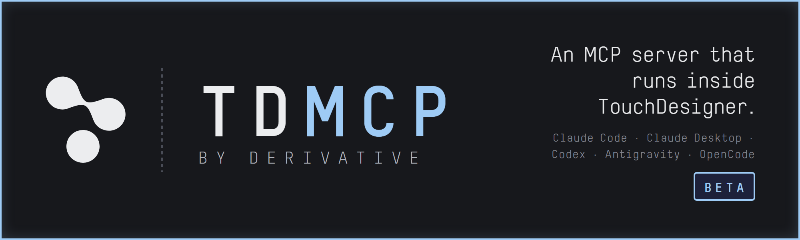
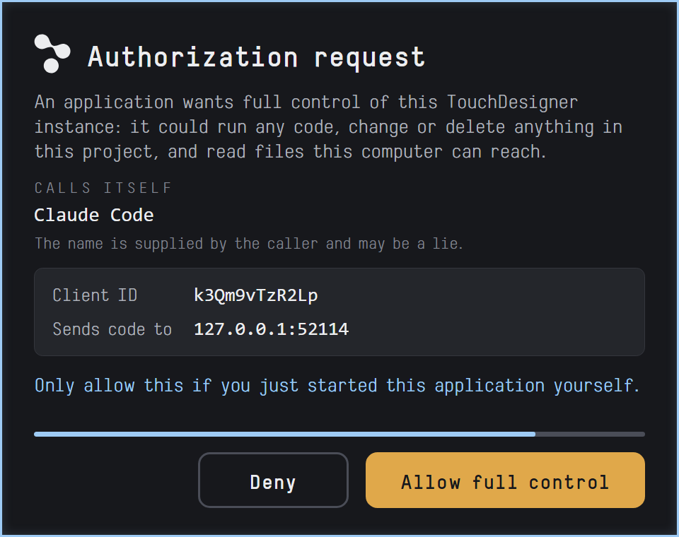

> ### Beta
>
> TDMCP is in public beta. The component works and is in daily use, but the
> interface may still change. Found a bug, or want to ask something? Start a
> [discussion](https://github.com/TouchDesigner/TDMCP/discussions) or open an
> [issue](https://github.com/TouchDesigner/TDMCP/issues). Please include your
> TouchDesigner build (**Help → About TouchDesigner**) and the TDMCP
> **Version** from the component's About page.

## What it is

TDMCP is an MCP server that runs inside TouchDesigner. Drop one component into
your project and your AI agent can build and edit networks with you: create
operators, wire them, set parameters, write DAT and GLSL code, read errors and
cook times, look up the TouchDesigner docs, and capture what an operator
outputs. Everything it does lands in TouchDesigner's undo stack, so Ctrl+Z
reverses it.

It is built for coding agents, Claude Code, Codex, Cursor, Antigravity and
OpenCode, and works with any client that speaks streamable-HTTP MCP. Claude
Desktop connects through a plugin: see [Claude Desktop](docs/claude-desktop.md).

## Start here

TDMCP lets an **AI agent** work inside your TouchDesigner project. You type
what you want, such as "make me an airplane with a script POP" or "why is
the render TOP black?", and the agent creates the operators, wires them and
sets the parameters, or helps diagnose the issue, while you watch it happen
in the network editor.

You run an agent in one of two ways.

- **In a terminal.** A terminal is the text window where you type commands:
  Terminal on macOS, PowerShell on Windows. An agent that runs there is called
  an agent CLI. You install it, open a terminal in your project folder, start
  it by typing its command, and talk to it there. The steps below are for
  these:

  | Agent | From | Command |
  |---|---|---|
  | **Claude Code** | Anthropic | `claude` |
  | Codex | OpenAI | `codex` |
  | Antigravity | Google | `agy` |
  | OpenCode | open source | `opencode` |

  Cursor, an editor with an agent built in, works too.
- **In an app.** **Claude Desktop** is the Claude app, with a window like any
  other program and no terminal. It connects through a plugin, with its own
  steps: [Claude Desktop](docs/claude-desktop.md).

Claude Code and Claude Desktop are the same Claude, from Anthropic. Claude
Code lives in the terminal; Claude Desktop is the app. Never used a terminal?
Start with Claude Desktop.

Requires **TouchDesigner 2025.33230 or newer**, and for the steps below, an
agent CLI that is already installed.

1. Download `TDMCP.tox` from [Releases](https://github.com/TouchDesigner/TDMCP/releases)
   and drag it into your project.
2. Turn on **Active** on the component's MCP page.
3. On the same page, pick your agent under **Install For**. Leave **Install
   Scope** on **Local**.
4. **Add MCP**, below it, holds the command for that agent. Click in the
   field, select the whole string and copy it.
5. Open a terminal in your project folder, paste the command and press Enter.
   The next session you start there has TouchDesigner's tools.
6. Back on the component, pulse **Install Skills**.

For Claude Code, **Add MCP** gives you:

```bash
claude mcp add --transport http --scope local touchdesigner http://127.0.0.1:13316/mcp
```

Already have the TouchDesigner plugin on your claude.ai account? Claude Code
is connected without steps 3 to 6. Don't register again on port 13316, or
every tool is listed twice. More in
[Claude Code and the plugin](docs/claude-desktop.md#claude-code-and-the-plugin).

Then ask your agent:

> What TouchDesigner project am I connected to?

Now try something real:

> Create a noise TOP, blur it, and end the chain in a null.

## Download

Every release carries the same files.

| File | What it is |
|---|---|
| **TDMCP.tox** | The component. This is the server. |
| **derivative_tdmcp.plugin** | The connection and the skills as one Claude plugin, for Claude Desktop and Claude Code. Other agents do not need it: they register the server with **Add MCP** and get the skills from **Install Skills**. |
| **TDMCP.json** | The version and checksum of the `.tox`, which the About page's **Update** button verifies. Nothing to do with it by hand. |

## What you can do

| | |
|---|---|
| **Build** | Create and wire operators, set parameters, add custom parameters, write DATs and shaders, lay out and annotate the network. One call can build a whole chain. |
| **Inspect** | Read CHOP channels, TOP pixels, geometry and DAT content. Capture any operator as an image. Trace errors and cook times. |
| **Learn** | The agent reads TouchDesigner's own documentation through `get_docs`, and looks up parameter names and menu values before it sets them. |
| **Watch** | The network editor pans to whatever the agent is touching and flashes it: amber for edits, blue for inspections, violet for views. |
| **Undo** | Every change the agent makes is an undo step. There is an option to ask first before deleting an operator. |

26 tools in all. The full list, with what each one does, is in the
[component reference](docs/component.md#tools).

## Skills

Skills teach the agent how TouchDesigner works: one guide per operator
family, the conventions for network layout and performance, and a workflow for
planning, reviewing and cleaning up. Without them, the agent might guess
at parameter names and build networks that don't work.

The skills live in [TDMCPSkills](https://github.com/TouchDesigner/TDMCPSkills).
Claude gets them from the plugin, with nothing to install. For other agents,
pulse **Install Skills** on the component and it fetches the latest release
and puts it where your client looks. Use one route per client: with the
plugin providing the skills, **Install Skills** installs nothing for Claude,
because a second copy lists every skill twice. The
[component reference](docs/component.md#skills) lists the directory for each
client.

## Stay in control

The server exposes `execute_code`, which runs Python inside TouchDesigner.
Treat a connection to it as you would a shell on your machine.

- **Authentication is on by default.** The first time a client connects,
  TouchDesigner shows a consent panel naming the client that is asking.
  Nothing gets control until you allow it there.
- **Localhost only, by default.** Requests from other machines are refused
  before anything runs. Opening the server to a network requires HTTPS and
  authentication together.
- **Nothing is sent home.** No telemetry, no analytics, no account. The
  component only reaches GitHub when you ask it to install skills or update.



More in [Security and privacy](docs/security.md).

## Documentation

- [Component reference](docs/component.md): every parameter on the six pages,
  the tools, where skills land, and what TDMCP writes to disk
- [Claude Desktop](docs/claude-desktop.md): the plugin, Cowork, the Code tab,
  images, and Desktop troubleshooting
- [Advanced setup](docs/setup-advanced.md): other clients, HTTPS, several
  clients and instances, OAuth internals
- [Troubleshooting](docs/troubleshooting.md)
- [OpenCode and local models](docs/opencode.md)
- [Changelog](CHANGELOG.md)

## License

Shared Use License, see [LICENSE.md](LICENSE.md). Use and modify TDMCP for
your own projects, commercial or not. Do not redistribute TDMCP itself as a
product. Read the licence before shipping anything built on it.

## Support and feedback

Start a [discussion](https://github.com/TouchDesigner/TDMCP/discussions) or
open an [issue](https://github.com/TouchDesigner/TDMCP/issues). Please include
your TouchDesigner build (**Help → About TouchDesigner**), the TDMCP **Version**
from the component's About page, and what you asked the agent to do.

TDMCP is made by [Derivative](https://derivative.ca), the makers of
TouchDesigner.
